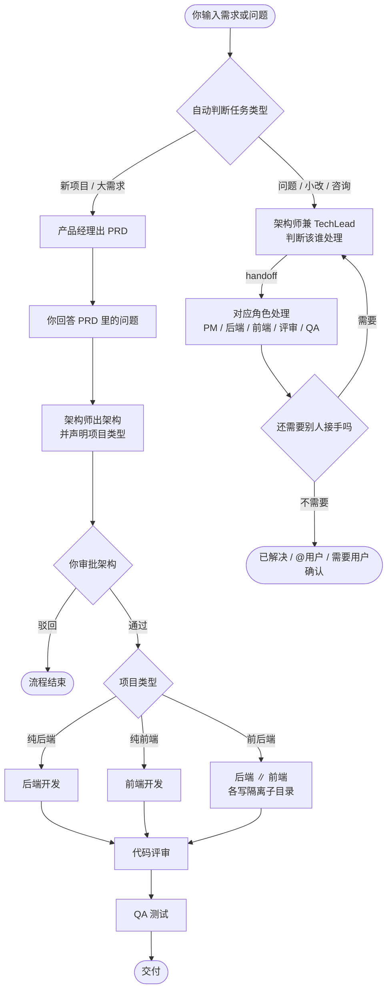

# 一个自己写的 AI 开发团队小工具

> 6 个 Agent 按流程协作：产品经理、架构师、后端、前端、代码评审、QA。
> 本地桌面端，代码开源，自己也在用。

[](LICENSE)
[](https://www.python.org/)

## 为什么写这个

我一个人写项目，最烦的不是写代码，是来回切换：

先想需求，再画架构，然后前后端、评审、测试全得自己来。  
我想要的是一个固定流程：角色分工、人工审批、代码评审、QA 都不能少。

所以用 Microsoft Agent Framework 做编排、PySide6 做桌面端，拼了这么个东西。  
不是商业产品，也没有团队，就是自己用 + 开源出来。

## 现在能做什么

- 6 个角色按流程走：需求 → PRD → 架构（你审批）→ 开发 → 评审 → QA
- 自动判断：纯后端 / 纯前端 / 前后端并行
- Agent 真的读写本地文件、执行命令、跑测试，不是只给代码片段
- 项目记忆 `memory.json`、会话 `session.json`、Token 用量 `usage.json`
- **RAG 检索式上下文**（Milvus Lite；装了 fastembed 用 bge-small-zh 语义向量，否则降级关键词检索），长项目不再靠截断
- **双模式**：标准开发流程 / 群聊协作（TechLead 自动判断，自动 @ 转交）
- 多项目、独立工作目录、停止运行、会话恢复
- Markdown / 代码块渲染
- 用自己的 API Key（DeepSeek / Kimi），只付 token

## 它大概怎么跑

输入一句话，先自动判断该走哪条路，然后按对应流程推进。



**左路：标准开发流程**

- 固定串行 SOP，评审和 QA 不会被跳过
- 架构审批是强卡点：不批准就直接结束，不会硬着头皮往下做
- 纯后端 → 评审 → QA；纯前端 → 评审 → QA
- 前后端 → 后端 ∥ 前端（两个独立子目录）→ 评审 → QA
- 并行时前端只依赖架构里的 API 契约，不等后端产出

**右路：群聊协作**

- 架构师兼 TechLead 判断归属，用结构化 handoff 把活交给对应角色，角色之间可以继续互转
- 收敛靠四道防循环：同一对 handoff 反复、handoff 总数超限、单角色重复输出、单角色工具调用超限；外面再套一个 24 条消息上限
- 终止词三种：`已解决` / `@用户` / `需要用户确认`

> CLI（`python main.py`）只走左路的标准流程，不走自动判断；桌面端才是两条路都会走的入口。

## 现在还不能做什么 / 已知问题

- **不是沙箱**：本机 `subprocess` + 命令白名单 + Git 快照，别在不可信环境跑
- **项目类型判断**：优先读架构里的结构化声明，声明缺失才用关键词启发式兜底（会提示低置信度）
- **UI 比较朴素**：还没做安装包、代码签名、自动更新
- **模型覆盖有限**：目前主要用 DeepSeek / Kimi 的 OpenAI 兼容接口，其他模型没充分测
- **测试脚本不保留**：QA 完成后会自动删除 `tests/`、`qa/` 和根目录测试文件

## 快速开始

> 目前**没有提供现成的安装包 / Release**，两种方式：直接用源码跑，或自己打包成 exe。

### 前置条件

- Python 3.10+（开发环境是 3.12）
- Git（Agent 执行命令时会用它做快照）
- 一个 OpenAI 兼容的模型 Key（DeepSeek / Kimi）

### 方式一：源码运行（推荐）

```bash
git clone https://github.com/LiuShiW/Description_agent_manager.git
cd Description_agent_manager

python -m venv .venv
# Windows CMD:          .venv\Scripts\activate
# Windows PowerShell:   .venv\Scripts\Activate.ps1
# macOS / Linux:        source .venv/bin/activate

pip install -r requirements.txt
python app/desktop_app.py
```

首次启动会自动从 `config/models.example.yaml` 复制出 `config/models.yaml`，在「⚙ 设置」里填 API Key 就能用。

**可选：开启语义检索**

`requirements.txt` 里的 `fastembed` 是注释掉的（带 onnxruntime，体积较大）。装上会启用 bge-small-zh 语义向量；不装则自动降级成 TF-IDF 关键词检索，功能不受影响：

```bash
pip install fastembed
```

### 方式二：CLI（固定流程，不自动分流）

```bash
python main.py "做一个待办应用"
```

CLI 走的是标准开发流程，需要你在终端里回答产品经理的问题、输入 `y` 审批架构。桌面端才是自动判断「标准流程 / 群聊协作」的入口。

### 方式三：网页原型（保留，非主入口）

```bash
streamlit run app/streamlit_app.py
```

### 自己打包 Windows exe

```bash
build_exe.bat
```

脚本会自动安装 PyInstaller、备份并恢复 `workspace/` 与用户配置、清理旧的 `dist`，产物在 `dist/AI软件团队/AI软件团队.exe`（onedir，整个目录一起分发）。

打包后可以跑一次冒烟测试，退出码 0 表示能正常启动：

```bash
"dist/AI软件团队/AI软件团队.exe" --smoke-test
```

## 配置

`config/models.yaml`：

```yaml
default:
  provider: deepseek
  model: deepseek-flash          # 或 deepseek-v4-pro
  api_key: "sk-..."
  base_url: "https://api.deepseek.com/v1"
  temperature: 0.2

# 每个角色可单独配置模型 / Key / Base URL
roles:
  arch:
    model: deepseek-v4-pro
  backend:
    model: deepseek-v4-pro
    # api_key: sk-another-key
    # base_url: https://api.deepseek.com/v1
```

也可以直接用桌面端的「⚙ 设置」修改。

## 技术栈

| 层 | 选型 |
|---|---|
| 编排 | Microsoft Agent Framework（autogen-agentchat） |
| 桌面端 | PySide6（Qt） |
| 模型 | DeepSeek / Kimi（BYOK，OpenAI 兼容接口） |
| 代码执行 | 本机 subprocess + 命令白名单 + Git 快照 |
| 记忆 | 项目级 `memory.json` + `session.json` |
| 检索 | Milvus Lite（pymilvus + milvus-lite）+ bge-small-zh（fastembed） |
| 协作 | AutoGen Swarm（handoff）：群聊协作模式 |
| 用量 | 项目级 `usage.json`（只统计 token） |

## 项目结构

```
├── app/
│   ├── desktop_app.py      # 原生桌面工作台（主入口）
│   └── streamlit_app.py    # 网页原型
├── src/
│   ├── pipeline.py         # 流水线 / 项目类型判断 / 群聊协作 / 统一入口
│   ├── swarm_team.py       # Swarm 团队 + LoopGuard 防循环
│   ├── agents.py           # 6 角色定义 + handoff 目标
│   ├── memory.py           # 项目记忆与 RAG 检索式上下文
│   ├── rag.py              # 切片 + embedding + Milvus 向量检索
│   ├── projects.py         # 多项目 / 工作目录
│   ├── usage.py            # Token 统计
│   ├── models.py           # 模型客户端工厂
│   └── tools/code_exec.py  # 命令 / 文件工具
├── config/
│   ├── agents.yaml         # 6 角色提示词
│   └── models.example.yaml # 模型配置模板
├── AGENTS.md               # 工程规约（可判定硬规则）
├── workspace/              # 运行时产出（不入库）
├── build_exe.bat           # 一键打包（自动备份/恢复）
└── scripts/build_exe.py
```

## License

[Apache-2.0](LICENSE)。第三方组件许可见 [NOTICE](NOTICE)。

## 反馈

有问题直接提 Issue，或者到仓库主页看最新进度：

https://github.com/LiuShiW/Description_agent_manager
