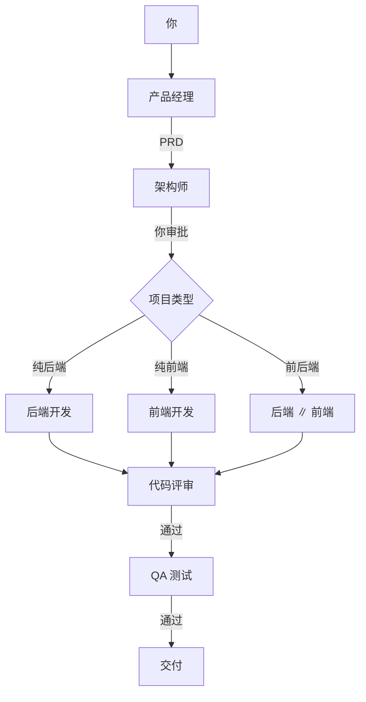

# 🧠 AI 软件团队 · Description Agent Manager

> **一个能自己组队写代码的本地 AI 开发团队。**
> 6 个角色在同一个工作台里协作：产品经理、架构师、后端、前端、代码评审、QA。
> 你只负责提需求、回答问题、审批架构。

[](LICENSE)
[](https://www.python.org/)
[]()
[]()

<p align="center">
  <b>不是“一个 AI 帮你写代码”，而是“一支 AI 团队帮你交付项目”。</b>
</p>

---

## 🎬 30 秒看懂

| 你做什么 | AI 团队做什么 |
|---|---|
| 提一句需求 | 产品经理拆成 PRD |
| 回答几个问题 | 架构师出架构与 API 契约 |
| 点一下「批准」 | 纯后端 / 纯前端 / 前后端并行开发 |
| 看群聊 | 代码评审 + QA 自动接力 |
| 拿结果 | 代码、文档、测试报告落在本地 |

```
需求 → PRD → 架构（你审批）→ 开发 → 代码评审 → QA → 交付
```

## ✨ 为什么值得试

- 👥 **6 个专职角色**，不是单个聊天机器人
- 🧩 **自动判断项目类型**：纯后端 / 纯前端 / 前后端并行
- 🛠 **真的动手**：读写本地文件、执行命令、跑测试，不是只给代码片段
- ✅ **关键节点由你把关**：架构审批 + 代码评审 + QA
- 🧠 **项目记忆**：PRD、架构、交付物按项目保存
- 📂 **多项目**：每个项目独立工作目录、会话与用量
- 📝 **Markdown 渲染**：PRD、架构、代码块清晰展示
- 🔢 **Token 用量**：按项目、按运行、按角色统计
- 💰 **BYOK**：用自己的 API Key，只付 token，没有平台订阅
- 🖥 **原生桌面端**（PySide6），不依赖浏览器
- 🔁 **Git 快照**：每次执行前自动提交，可回滚

## 📸 界面预览

> 📷 **截图位**：建议放「左侧 6 个角色 + 中间大群聊 + 底部审批按钮」的桌面截图。
>
> 把图片放到 `docs/assets/`，然后把下面这行替换成图片标签：
>
> ``

<!-- 截图示例：
<p align="center">
  
</p>
-->

## 🚀 快速开始

### 方式一：下载 exe（推荐给非开发者）

1. 下载 Release 里的 `AI软件团队` 压缩包
2. 解压后双击 `AI软件团队.exe`
3. 首次启动填入 API Key（DeepSeek / Kimi 等）
4. 输入需求 → 回答产品经理的问题 → 审批架构

### 方式二：源码运行

```bash
git clone https://github.com/LiuShiW/Description_agent_manager.git
cd Description_agent_manager
python -m venv .venv
# Windows: .venv\Scripts\activate
pip install -r requirements.txt
python app/desktop_app.py
```

打包 Windows exe：

```bash
build_exe.bat
```

产物：`dist/AI软件团队/AI软件团队.exe`。

## 🧭 它是怎么工作的



- **纯后端**：后端 → 评审 → QA
- **纯前端**：前端 → 评审 → QA
- **前后端**：后端 ∥ 前端 → 评审 → QA
- 前后端并行时，前端只依赖架构里的 **API 契约**，不等待后端产出

## 🆚 和常见方案的区别

| 方案 | 差异 |
|---|---|
| **Coze / WorkBuddy** | 本项目本地运行、BYOK；代码和提示词直接发给你配置的模型 API，不经过第三方编排平台 |
| **Cursor / Claude Code** | 它们是单 Agent 编码；本项目是 6 角色 + 审批 + 评审 + QA 的完整流程 |
| **自己写脚本调 API** | 角色、群聊、工具、项目记忆、桌面 UI 都是现成的 |

> 不同工具定位不同，这里只对比“多角色开发流程”这一点。

## 🎯 适合谁

- 想低成本体验「AI 团队开发」的个人开发者
- 需要快速产出 demo / 内部工具的小团队
- 想研究多 Agent 编排、Prompt、工具调用的开发者
- 想要本地优先、代码不经过第三方平台的用户

## ⚠️ 不适合谁

- 需要企业级容器沙箱 / 合规审计的生产环境（当前是本机执行 + 命令白名单 + Git 快照）
- 完全不想配置 API Key 的用户
- 期望“一句话直接上线大型系统”的用户

## 🧰 技术栈

| 层 | 选型 |
|---|---|
| 编排 | Microsoft Agent Framework（autogen-agentchat） |
| 桌面端 | PySide6（Qt） |
| 模型 | DeepSeek / Kimi（BYOK，OpenAI 兼容接口） |
| 代码执行 | 本机 subprocess + 命令白名单 + Git 快照 |
| 记忆 | 项目级 `memory.json` + `session.json` |
| 用量 | 项目级 `usage.json`（只统计 token） |

## 🔧 配置

`config/models.yaml`：

```yaml
default:
  provider: deepseek
  model: deepseek-flash          # 或 deepseek-v4-pro
  api_key: "sk-..."
  base_url: "https://api.deepseek.com/v1"
  temperature: 0.2

# 每个角色可单独配置模型 / Key / Base URL
roles:
  arch:
    model: deepseek-v4-pro
  backend:
    model: deepseek-v4-pro
    # api_key: sk-another-key
    # base_url: https://api.deepseek.com/v1
```

也可以直接用桌面端的「⚙ 设置」修改。

## 🧠 项目记忆与上下文

- 每个项目保存 `memory.json`：需求、PRD、Leader 答复、架构、前后端交付、评审、QA
- 每个角色只拿自己需要的上下文，不把全量文本塞给所有模型
- 单字段超过 12000 字符会自动截断
- `session.json` 是界面聊天记录；`memory.json` 是结构化项目记忆

## 🔢 Token 用量

- **只统计 token，不计算金额、不设预算**（各厂商价格/缓存/折扣差异大，避免内置价格滞后）
- 按项目保存 `usage.json`，每次运行/对话一条记录
- 桌面端「📊 用量详情」可看本次、项目累计、最近运行与各角色明细

## 📁 项目结构

```
├── app/
│   ├── desktop_app.py      # 原生桌面工作台（主入口）
│   └── streamlit_app.py    # 网页原型
├── src/
│   ├── pipeline.py         # 流水线与项目类型判断
│   ├── agents.py           # 6 角色定义
│   ├── memory.py           # 项目记忆与按角色上下文
│   ├── projects.py         # 多项目 / 工作目录
│   ├── usage.py            # Token 统计
│   ├── models.py           # 模型客户端工厂
│   └── tools/code_exec.py  # 命令 / 文件工具
├── config/
│   ├── agents.yaml         # 6 角色提示词
│   └── models.example.yaml # 模型配置模板
├── workspace/              # 运行时产出（不入库）
├── build_exe.bat           # 一键打包（自动备份/恢复）
└── scripts/build_exe.py
```

## 🗺 Roadmap

- [x] 6 角色流水线 + 人工审批
- [x] 多项目 / 会话持久化
- [x] Token 用量统计
- [x] 项目记忆 + Markdown 渲染
- [x] 纯后端 / 纯前端 / 前后端自动并行
- [ ] 沙箱化代码执行（Docker / WSL）
- [ ] 安装包 / 代码签名 / 自动更新
- [ ] 多模型管理 UI
- [ ] 导出项目与对话

## ⭐ 如果这个项目对你有帮助

点个 **Star**，或者提 Issue 告诉我你想看的功能。

- 仓库：https://github.com/LiuShiW/Description_agent_manager
- 问题反馈：Issues
- 安全报告：见 [SECURITY.md](SECURITY.md)

## 🤝 贡献

见 [CONTRIBUTING.md](CONTRIBUTING.md)。

## 📄 License

[Apache-2.0](LICENSE)。第三方组件许可见 [NOTICE](NOTICE)。
