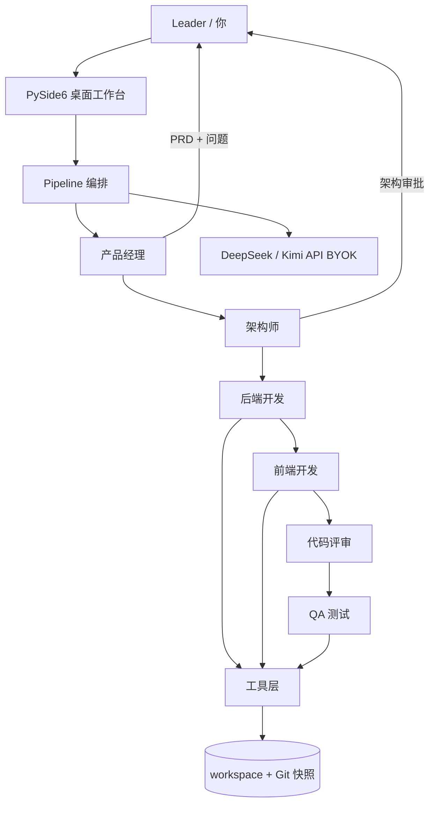

# Description Agent Manager · AI 软件团队

[](LICENSE)
[](https://www.python.org/)
[]()

**本地优先的 6 角色 AI 软件开发团队：群聊、私聊、人审、真实落盘。**

一个 Codex 风格的桌面工作台：产品经理 → 架构师 → 后端 → 前端 → 评审 → QA 在同一个群聊里协作；
你可以点开任意角色单独下指令，也可以在关键节点审批。模型 BYOK（自带 Key），只付 Token。

---

## ✨ 功能

- **6 角色流水线**：产品经理 / 架构师 / 后端 / 前端 / 代码评审 / QA
- **群聊 + 角色私聊**：群聊看全部消息；点角色看其历史并单独下指令
- **人工审批**：PRD 问题由你回答，架构方案由你批准/驳回
- **真实落盘**：开发角色通过工具把代码写入 `workspace/`
- **安全兜底**：命令白名单、执行前 Git 快照、超时、异常兜底
- **测试即用即清**：QA 完成后自动清理测试脚本
- **原生桌面**：PySide6（Qt），不依赖浏览器
- **BYOK**：DeepSeek（默认 flash），可按角色切 Pro；无平台订阅费

## 🏗️ 架构



## 🚀 快速开始（源码运行）

```bash
git clone https://github.com/liuMou-dot/Description_agent_manager.git
cd Description_agent_manager
python -m venv .venv
# Windows: .venv\Scripts\activate
pip install -r requirements.txt
python app/desktop_app.py
```

首次启动会弹出配置向导，填入你的 DeepSeek API Key 即可。

也可以手动配置：

```bash
copy config\models.example.yaml config\models.yaml
# 编辑 config\models.yaml，填入 api_key
```

## ⚙️ 配置

`config/models.yaml`：

```yaml
default:
  provider: deepseek
  model: deepseek-flash          # 或 deepseek-v4-pro
  api_key: "sk-..."
  base_url: "https://api.deepseek.com/v1"
  temperature: 0.2

# 单次运行预算上限（元），0 = 不限
budget_cny: 0

# 可选：按角色单独配置（未填字段回落到 default）
roles:
  # arch:
  #   model: deepseek-v4-pro
  # backend:
  #   model: deepseek-v4-pro
  #   api_key: sk-your-other-key
  #   base_url: https://api.deepseek.com/v1
```

- DeepSeek OpenAI 兼容端点：`https://api.deepseek.com/v1`
- 若以后接 Claude Code：Anthropic 兼容端点是 `https://api.deepseek.com/anthropic`（注意不是 `/v1`）

## 📦 打包 Windows 可执行程序

```bash
build_exe.bat
```

产物：`dist/AI软件团队/AI软件团队.exe`（onedir，整个 `AI软件团队` 文件夹一起分发）。

> 打包前请确认 `config/models.yaml` 不含真实 Key；分发时只带 `models.example.yaml` 更安全。

## 📁 项目结构

```
├── app/
│   ├── desktop_app.py      # 原生桌面工作台（PySide6，主入口）
│   └── streamlit_app.py    # 网页原型（保留）
├── src/
│   ├── pipeline.py         # 6 角色流水线
│   ├── agents.py           # 角色定义
│   ├── teams.py            # 群聊 / 单代理阶段
│   ├── models.py           # 模型客户端工厂
│   ├── paths.py            # 开发/打包路径兼容
│   └── tools/code_exec.py  # run_cmd / write_file / read_file
├── config/
│   ├── agents.yaml         # 6 角色提示词
│   └── models.example.yaml # 模型配置模板
├── workspace/              # 运行时产出（不入库）
├── desktop_app.spec        # PyInstaller 配置
└── build_exe.bat
```

## 🗺️ Roadmap

- [ ] 多项目管理与会话历史
- [ ] Token / 成本统计与预算上限
- [ ] 停止 / 重试 / 断点续跑
- [ ] 多模型管理（DeepSeek / Kimi / OpenAI / Ollama）
- [ ] 沙箱化代码执行（Docker / WSL）
- [ ] 团队协作、云端同步、审计（Pro）
- [ ] 安装包、代码签名、自动更新

## 🔒 安全说明

当前代码执行是**本机 subprocess + 白名单**，不是沙箱。请只在可信环境运行；
不要把含真实 Key 的 `config/models.yaml` 提交到仓库。

## 🤝 贡献

见 [CONTRIBUTING.md](CONTRIBUTING.md)。安全问题请按 [SECURITY.md](SECURITY.md) 私下报告。

## 📄 License

[Apache-2.0](LICENSE)。第三方组件许可见 [NOTICE](NOTICE)。
