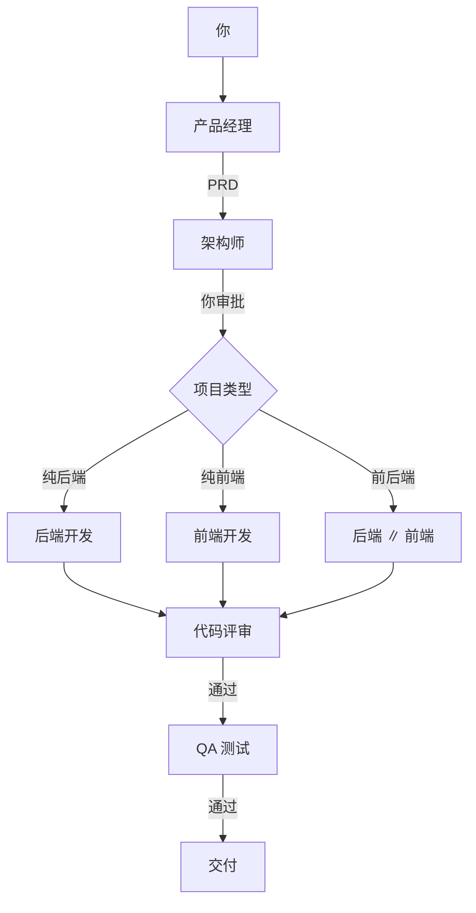

# 一个自己写的 AI 开发团队小工具

> 6 个 Agent 按流程协作：产品经理、架构师、后端、前端、代码评审、QA。
> 本地桌面端，代码开源，自己也在用。

[](LICENSE)
[](https://www.python.org/)

## 为什么写这个

我一个人写项目，最烦的不是写代码，是来回切换：

先想需求，再画架构，然后前后端、评审、测试全得自己来。  
我想要的是一个固定流程：角色分工、人工审批、代码评审、QA 都不能少。

所以用 Microsoft Agent Framework 做编排、PySide6 做桌面端，拼了这么个东西。  
不是商业产品，也没有团队，就是自己用 + 开源出来。

## 现在能做什么

- 6 个角色按流程走：需求 → PRD → 架构（你审批）→ 开发 → 评审 → QA
- 自动判断：纯后端 / 纯前端 / 前后端并行
- Agent 真的读写本地文件、执行命令、跑测试，不是只给代码片段
- 项目记忆 `memory.json`、会话 `session.json`、Token 用量 `usage.json`
- **RAG 检索式上下文**（Milvus + bge-small-zh），长项目不再靠截断
- **双模式**：标准开发流程 / 群聊协作（TechLead 自动判断，自动 @ 转交）
- 多项目、独立工作目录、停止运行、会话恢复
- Markdown / 代码块渲染
- 用自己的 API Key（DeepSeek / Kimi），只付 token

## 它大概怎么跑



- **纯后端**：后端 → 评审 → QA
- **纯前端**：前端 → 评审 → QA
- **前后端**：后端 ∥ 前端 → 评审 → QA
- 前后端并行时，前端只依赖架构里的 API 契约，不等待后端产出

## 现在还不能做什么 / 已知问题

- **不是沙箱**：本机 `subprocess` + 命令白名单 + Git 快照，别在不可信环境跑
- **项目类型判断**：优先读架构里的结构化声明，声明缺失才用关键词启发式兜底（会提示低置信度）
- **UI 比较朴素**：还没做安装包、代码签名、自动更新
- **模型覆盖有限**：目前主要用 DeepSeek / Kimi 的 OpenAI 兼容接口，其他模型没充分测
- **测试脚本不保留**：QA 完成后会自动删除 `tests/`、`qa/` 和根目录测试文件

## 快速开始

### 下载 exe

1. 下载 Release 里的 `AI软件团队` 压缩包
2. 解压后双击 `AI软件团队.exe`
3. 首次启动填入 API Key
4. 输入需求 → 回答产品经理的问题 → 审批架构

### 源码运行

```bash
git clone https://github.com/LiuShiW/Description_agent_manager.git
cd Description_agent_manager
python -m venv .venv
# Windows: .venv\Scripts\activate
pip install -r requirements.txt
python app/desktop_app.py
```

打包 Windows exe：

```bash
build_exe.bat
```

产物：`dist/AI软件团队/AI软件团队.exe`。

## 配置

`config/models.yaml`：

```yaml
default:
  provider: deepseek
  model: deepseek-flash          # 或 deepseek-v4-pro
  api_key: "sk-..."
  base_url: "https://api.deepseek.com/v1"
  temperature: 0.2

# 每个角色可单独配置模型 / Key / Base URL
roles:
  arch:
    model: deepseek-v4-pro
  backend:
    model: deepseek-v4-pro
    # api_key: sk-another-key
    # base_url: https://api.deepseek.com/v1
```

也可以直接用桌面端的「⚙ 设置」修改。

## 技术栈

| 层 | 选型 |
|---|---|
| 编排 | Microsoft Agent Framework（autogen-agentchat） |
| 桌面端 | PySide6（Qt） |
| 模型 | DeepSeek / Kimi（BYOK，OpenAI 兼容接口） |
| 代码执行 | 本机 subprocess + 命令白名单 + Git 快照 |
| 记忆 | 项目级 `memory.json` + `session.json` |
| 检索 | Milvus Lite（pymilvus + milvus-lite）+ bge-small-zh（fastembed） |
| 协作 | AutoGen Swarm（handoff）：群聊协作模式 |
| 用量 | 项目级 `usage.json`（只统计 token） |

## 项目结构

```
├── app/
│   ├── desktop_app.py      # 原生桌面工作台（主入口）
│   └── streamlit_app.py    # 网页原型
├── src/
│   ├── pipeline.py         # 流水线与项目类型判断
│   ├── agents.py           # 6 角色定义
│   ├── memory.py           # 项目记忆与 RAG 检索式上下文
│   ├── rag.py              # 切片 + embedding + Milvus 向量检索
│   ├── projects.py         # 多项目 / 工作目录
│   ├── usage.py            # Token 统计
│   ├── models.py           # 模型客户端工厂
│   └── tools/code_exec.py  # 命令 / 文件工具
├── config/
│   ├── agents.yaml         # 6 角色提示词
│   └── models.example.yaml # 模型配置模板
├── AGENTS.md               # 工程规约（可判定硬规则）
├── workspace/              # 运行时产出（不入库）
├── build_exe.bat           # 一键打包（自动备份/恢复）
└── scripts/build_exe.py
```

## 开发记录（踩过的坑）

- **群聊自由发言不收敛**：Selector 模式会互相空转，后来改成串行单阶段
- **终止标记被任务文本误触发**：任务里写了「交付完成」，阶段一开始就结束；现在任务文本不再出现标记
- **PyInstaller 打包 PySide6 报 ICU DLL 找不到**：PyArrow 的 ICU 抢占了系统 ICU，打包时过滤掉
- **不同 Agent 不同模型时上下文没法共享**：只能显式交接，所以加了 `memory.json` 按角色裁剪
- **QA 产出测试脚本后不想留一堆文件**：QA 完成后自动清理

## License

[Apache-2.0](LICENSE)。第三方组件许可见 [NOTICE](NOTICE)。

## 反馈

有问题直接提 Issue，或者到仓库主页看最新进度：

https://github.com/LiuShiW/Description_agent_manager
